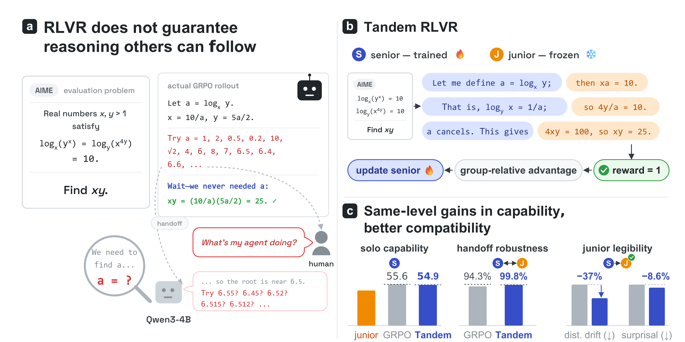

# Tandem RLVR

**[Final report (PDF)](final_report.pdf)** · **[Model weights on Hugging Face](https://huggingface.co/cge7-tandem-rlvr/tandem-rlvr)**

Tandem RLVR trains a senior LLM with GRPO while a frozen junior model writes
alternating parts of each rollout. Only the senior's tokens are updated. This
repository reproduces the method on Qwen3-4B and extends it to a Qwen3.5-9B
senior with a 2B junior, and to coding and shorthand pilots.



## Rerunning the experiments

Requirements: Linux, 2 NVIDIA 80 GB GPUs (A100/H100/H200), ~144 GB host RAM, and [`uv`](https://docs.astral.sh/uv/).
Slurm is optional; the `slurm/` wrappers only add scheduling and resumption.

**1. Install** (Python 3.11, pinned patched verl/vLLM; see [docs/INSTALL.md](docs/INSTALL.md)):

```bash
export REPO="$PWD" RUN_ROOT="$PWD/runs" UV_BIN_DIR="$(dirname "$(command -v uv)")"
TANDEM_ENV="$PWD/.envs/training"  PROFILE=training  PREPARE_FORKS=1 bash slurm/setup.sh
TANDEM_ENV="$PWD/.envs/inference" PROFILE=inference bash slurm/setup.sh
```

**2. Prepare data** (DeepScaleR: 39,309 train / 1,000 validation rows):

```bash
uv run --no-project --python .envs/training/bin/python python data/build_deepscaler.py --out-dir data/deepscaler
```

**3. Train both arms** (200 steps; checkpoints in `checkpoints/<run>/hf/global_step_N`):

```bash
cp train/env.sh.example train/env.sh   # set TANDEM_ENV_BIN=$PWD/.envs/training/bin
GPUS=0,1 TOTAL_STEPS=200 bash train/vanilla_grpo.sh
GPUS=0,1 TOTAL_STEPS=200 bash train/tandem_grpo.sh
```

Pick each arm's best validation checkpoint (from the logged `val` score), or skip
training and download ours: `uvx hf download cge7-tandem-rlvr/tandem-rlvr --local-dir released`.

**4. Evaluate** solo pass@k (32 samples) and paragraph handoff to the frozen junior (8 chains) on AMC, AIME, Minerva and OlympiadBench:

```bash
export PATH="$PWD/.envs/inference/bin:$PATH" JUNIOR=Qwen/Qwen3-4B-Instruct-2507
python eval/solo.py --model $JUNIOR --out results/figure2/base/solo.json --n 32
for arm in grpo tandem; do
  python eval/solo.py --model released/$arm --out results/figure2/$arm/solo.json --n 32
  python eval/handoff.py --senior released/$arm --junior $JUNIOR --out results/figure2/$arm/handoff.json --n 8
done
```

**5. Plot:**

```bash
uv run --no-project --python .envs/inference/bin/python python eval/figure2.py \
  --results results/figure2 --out results/figure2/figure2
```

Details: [training protocol](docs/FRESH_TRAINING.md) ·
[evaluation protocol](docs/FIGURE2.md) · [9B/2B pair](docs/QWEN35_PAIR.md) ·
[other experiments](experiments/README.md) · [results](docs/RESULTS.md).
