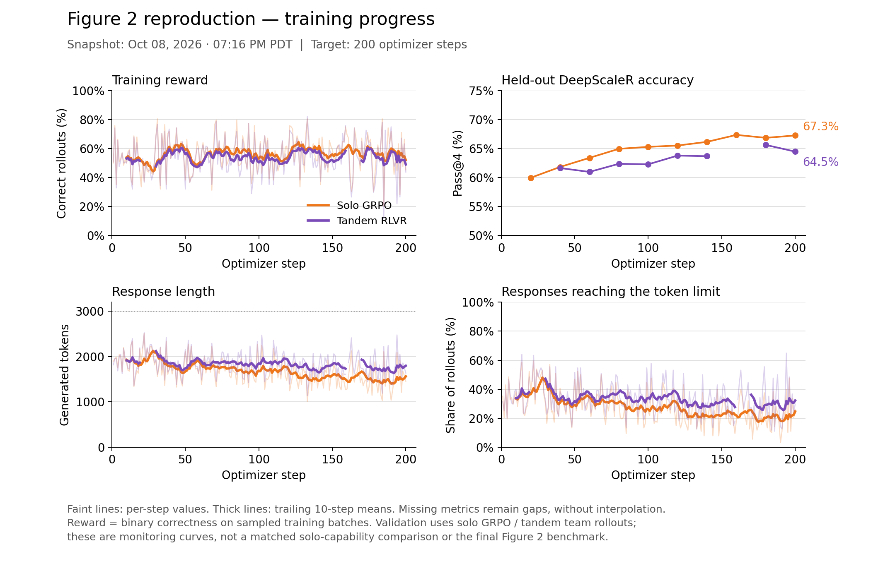

# Tandem RLVR: replication and extensions

We compare solo GRPO with Tandem RLVR: a senior language model learns to solve
problems alongside a frozen junior. The question is whether training together
preserves solo accuracy while making reasoning easier for a weaker partner to continue.

## Reproduce

See the [setup](docs/WORKFLOWS.md),
[training](docs/FRESH_TRAINING.md) and [evaluation](docs/FIGURE2.md) protocols.

| Step | Entry points |
| --- | --- |
| Prepare data | [DeepScaleR builder and manifest](data/build_deepscaler.py) |
| Train both arms | [Submit jobs](slurm/submit-training.sh), [training job](slurm/train-figure2.sbatch), [GRPO](train/vanilla_grpo.sh), [Tandem](train/tandem_grpo.sh) |
| Select checkpoints | [Verify weights](train/figure2_checkpoint.py), [select and write model manifest](eval/select_figure2.py) |
| Evaluate | [Evaluation job](slurm/figure2.sbatch), [solo](eval/solo.py), [paragraph handoff](eval/handoff.py), [junior cross-entropy](eval/legibility.py) |
| Aggregate results | [Figure 2](eval/figure2.py), [regrade saved answers](eval/regrade.py), [result format](eval/common.py) |

## Data and evaluation

The main reproduction starts both arms from **Qwen3-4B-Instruct-2507** and trains
for 200 updates on DeepScaleR: 39,309 training rows and 1,000 validation rows.
Tandem freezes a copy of the base model and updates only senior-authored tokens.

Evaluation covers **1,064 problems** from AMC, AIME, Minerva and OlympiadBench.
Solo evaluation uses 32 samples per problem; paragraph handoff uses eight chains.
Pass@k estimates success in k attempts, and macro scores weight each benchmark equally.
Training switches at word boundaries; the main handoff benchmark switches at paragraphs.

## Replication results

The 4B runs show **similar solo accuracy and no clear handoff advantage**.
Validation selected GRPO step 160 and Tandem step 180.

| Corrected macro score | GRPO | Tandem |
| --- | ---: | ---: |
| Solo pass@4 | 59.46% | 59.97% |
| Paragraph handoff pass@4 | 58.25% | 57.55% |
| Paragraph handoff pass@8 | 61.79% | 60.48% |

Tandem's marginal token-distribution drift is **15.13% lower** than GRPO's
([Figure 3](docs/FIGURE3.md)). Each arm has one training run. Both trained with an
incomplete math verifier; corrected evaluation cannot repair those training rewards.
See the [grading audit](docs/REPRODUCTION_AUDIT.md) and [full results](docs/RESULTS.md).

## Figure 2 reproductions

Pass@k with ±1 bootstrap SE; top row is paragraph handoff with the frozen junior, bottom row is solo.

Qwen3-4B-Instruct-2507 senior and junior ([grading audit](docs/REPRODUCTION_AUDIT.md)):

Qwen3.5-9B senior with frozen Qwen3.5-2B junior ([pair notes](docs/QWEN35_PAIR.md)):

## Extensions

| Experiment | Question and recorded outcome |
| --- | --- |
| [9B senior / 2B junior](docs/QWEN35_PAIR.md) | Does Tandem extend to a 9B senior with a 2B junior? Both policies are released; original benchmark plot and scores are pending here. [Workflow](experiments/README.md#asymmetric-qwen35-pair), [pair probe](train/check_pair.py). |
| [Native word handoff](experiments/README.md#native-word-handoff) | Evaluate the training-time switching schedule. The partial comparison shows no clear advantage. [Execution details](docs/WORD_HANDOFF_EXECUTION.md). |
| [Shorthand and concepts](experiments/README.md#shorthand-and-concepts) | Can repeated operations develop reusable shorthand? Matrix and RuleTaker accuracy improves; useful opaque shorthand is not established. |
| [Length pressure](docs/LENGTH_PENALTY_PILOTS.md) | Does a token cost preserve correctness? Accuracy falls substantially, especially on matrix tasks. |
| [Natural-language drift](experiments/README.md#natural-language-drift) | Does correctness-only RL change small base models' language? No final results are reported. |
| [Method Atlas](docs/METHOD_AUDIT.md) / [elegance RL](docs/ELEGANCE_RL.md) | Build method holdouts and reward elegant derivations. The dataset contains 374 problems and 1,840 paths; final RL comparison is pending. |
| [APPS coding](docs/APPS.md) | Extend Tandem to executable program tests. Both policies are released; final aggregate evaluation is pending. [Migration record](docs/APPS_MIGRATION.md). |
| [MedCalc](experiments/medcalc/README.md) | Extend the comparison to verified clinical calculations. The pipeline is implemented; results are not reported. |

[Experiment workflows](experiments/README.md) include diagrams, code and detailed records.

## Results plots

Summary values from the repository; error bars are unavailable in this checkout.
[Data and plotting script](docs/figures/README.md#reproducible-summary-plots).

**Solo-RL pilots:** one run per condition, evaluated at step 100. Matrix uses a
3K-token budget; RuleTaker uses 4K and requires all four answers to be correct.

### Asymmetric benchmark: 9B senior / 2B junior

> **Figure to add:** original Qwen3.5-9B / frozen-2B benchmark plot and score JSON.
> Show AMC, AIME, Minerva, Olympiad and macro pass@k, with handoff above and solo below.

### Training progress

Orange is GRPO; purple is Tandem. Faint lines show individual steps and bold lines
show trailing ten-step means. These are training diagnostics; validation uses
each arm's own rollout protocol.

Other existing figures: [optimization diagnostics](results/training-progress/completed-diagnostics-20261008.png),
[earlier GRPO-only snapshot](results/training-progress/solo-20261008.png), and
[original paper overview](docs/teaser.png). The paper overview's numbers are not this
replication's results. [All figure files and sources](docs/figures/README.md).

## Released checkpoints

Weights are on [Hugging Face](https://huggingface.co/cge7-tandem-rlvr/tandem-rlvr).
Use the listed `subfolder=`; Tandem exports contain the trained senior only.

| Subfolder | Senior / frozen junior | Step | Validation pass@4 |
| --- | --- | ---: | ---: |
| `grpo` | Qwen3-4B / none | 160 | 0.674 |
| `tandem` | Qwen3-4B / Qwen3-4B | 180 | 0.656 |
| `qwen35-9b-2b/grpo` | Qwen3.5-9B / none | 200 | 0.752 |
| `qwen35-9b-2b/tandem` | Qwen3.5-9B / Qwen3.5-2B | 200 | 0.694 |
| `apps/grpo` | Qwen3-4B / none | 200 | 0.785 |
| `apps/tandem` | Qwen3-4B / Qwen3-4B | 200 | 0.780 |

These validation scores use each arm's rollout protocol and are not matched test
comparisons. The hosted `checkpoint_manifest.json` records model revisions,
selection evidence and hashes.

## Implementation

- [Architecture](docs/ARCHITECTURE.md), [fork patches](third_party/COMMIT_LOG.md) and [tests](tests/README.md): sampler, authorship masking and verification.
- [Execution options](train/execution.sh) and [checkpoint storage](docs/ARCHITECTURE.md#other-fork-changes): runtime settings and recovery.
- [Training plots](eval/training_progress.py) and [token-drift analysis](eval/figure3.py): regenerate diagnostics from saved outputs.
- [Comparison browser](eval/comparison_browser.py) and [trace interface](ui/comparison/): inspect saved model responses.
