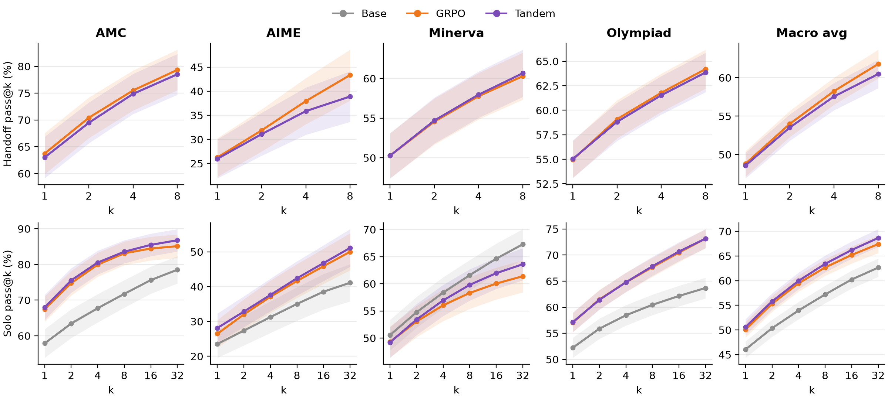
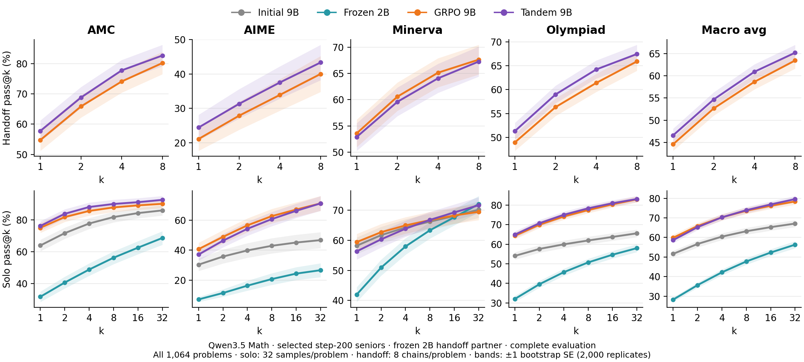

# Tandem RLVR: replication and extensions

We compare solo GRPO with Tandem RLVR: a senior language model learns to solve
problems alongside a frozen junior. We test whether this preserves solo accuracy
and produces reasoning the junior can continue.

<a id="headline-reproduction"></a>
<a id="inspect-results"></a>
<a id="figure-2-reproductions"></a>
<a id="results-plots"></a>

<a id="replication-results"></a>

## Replication: Qwen3-4B

**Research question:** Does Tandem preserve solo performance while improving handoff to a frozen partner?

**TL;DR results: Solo accuracy is similar; Tandem shows no aggregate paragraph-handoff gain in the 4B reproduction.**

Both models start from Qwen3-4B-Instruct-2507. Validation selects GRPO step 160
and Tandem step 180. The complete, regraded evaluation covers 1,064 problems.



Top: paragraph handoff. Bottom: solo. Bands show ±1 bootstrap standard error.

| Corrected macro score | GRPO | Tandem |
| --- | ---: | ---: |
| Solo pass@4 | 59.46% | 59.97% |
| Paragraph handoff pass@4 | 58.25% | 57.55% |
| Paragraph handoff pass@8 | 61.79% | 60.48% |

Tandem's marginal token-distribution drift is **15.13% lower**
([Figure 3 analysis](docs/FIGURE3.md)). Each arm has one training run; both used
an incomplete math verifier. Regrading corrects evaluation, not training rewards.
[Grading audit](docs/REPRODUCTION_AUDIT.md) · [Full results](docs/RESULTS.md)

<a id="experiment-workflows"></a>
<a id="what-each-variation-tests"></a>

## Extensions

<a id="asymmetric-benchmark-9b-senior--2b-junior"></a>

### 1. 9B senior / 2B junior — full benchmark evaluation

**Research question:** Does Tandem improve a 9B model's handoff to a smaller, frozen 2B partner?

**TL;DR results: Tandem improves macro handoff performance while retaining broadly similar solo performance. Handoff gains appear on AMC, AIME and Olympiad, but not Minerva.**

Both Qwen3.5 seniors are evaluated at step 200 on all 1,064 problems, with a
frozen Qwen3.5-2B handoff partner.



Top: paragraph handoff. Bottom: solo. Bands show ±1 bootstrap standard error.

[Pair setup and results](docs/QWEN35_PAIR.md) ·
[Workflow](experiments/README.md#asymmetric-qwen35-pair) · [Pair probe](train/check_pair.py)

### 2. Shorthand and length pressure — solo-RL pilots

**Research question:** Can correctness rewards and shorter reasoning encourage reusable shorthand?

**TL;DR results: Training improves task accuracy, but useful opaque shorthand is not established. Adding a length penalty reduces accuracy, especially on matrix tasks.**


One training run per condition; trained policies evaluated at step 100. Matrix
uses a 3K-token budget; RuleTaker uses 4K and requires all four answers to be correct. These pilots test
solo RL, with no senior–junior handoff comparison.

[Shorthand and concept pilots](experiments/README.md#shorthand-and-concepts) ·
[Length-pressure results](docs/LENGTH_PENALTY_PILOTS.md) ·
[Plot data and code](docs/figures/README.md#reproducible-summary-plots)

### Other work

| Work | Type | Question and recorded outcome |
| --- | --- | --- |
| [Native word handoff](experiments/README.md#native-word-handoff) | Partial evaluation | Does the training-time switching schedule help? No clear advantage in the partial comparison. [Details](docs/WORD_HANDOFF_EXECUTION.md). |
| [Natural-language drift](experiments/README.md#natural-language-drift) | Pilot | Does correctness-only RL change small base models' language? No final results reported. |
| [Method Atlas](docs/METHOD_AUDIT.md) | Dataset and audit | Can we separate memorized methods from transfer? 374 problems and 1,840 solution paths assembled. |
| [Elegance RL](docs/ELEGANCE_RL.md) | Training extension | Does rewarding elegant derivations help? Final comparison pending. |
| [APPS coding](docs/APPS.md) | Domain extension | Does Tandem help on executable program tests? Both policies released; final aggregate evaluation pending. [Migration record](docs/APPS_MIGRATION.md). |
| [MedCalc](experiments/medcalc/README.md) | Implemented pipeline | Does Tandem help with verified clinical calculations? No empirical results reported. |

[Experiment index](experiments/README.md): workflow diagrams, code and detailed records.

<a id="data-and-core-records"></a>
<a id="training"></a>
<a id="evaluation"></a>
<a id="run-the-reproduction"></a>
<a id="data-and-evaluation"></a>

<a id="reproduce"></a>

## Data and reproduction

The 4B runs use 200 training updates on DeepScaleR: 39,309 training rows and
1,000 validation rows. Tandem updates only senior-authored tokens. Training
switches at word boundaries; the main handoff evaluation switches at paragraphs.
Evaluation uses 32 solo samples and eight handoff chains per problem across AMC,
AIME, Minerva and OlympiadBench. Macro scores weight the four benchmarks equally.

[Setup](docs/WORKFLOWS.md) · [Training protocol](docs/FRESH_TRAINING.md) ·
[Evaluation protocol](docs/FIGURE2.md)

| Step | Entry points |
| --- | --- |
| Prepare data | [DeepScaleR builder and manifest](data/build_deepscaler.py) |
| Train both arms | [Submit jobs](slurm/submit-training.sh), [training job](slurm/train-figure2.sbatch), [GRPO](train/vanilla_grpo.sh), [Tandem](train/tandem_grpo.sh) |
| Select checkpoints | [Verify weights](train/figure2_checkpoint.py), [select and write model manifest](eval/select_figure2.py) |
| Evaluate | [Evaluation job](slurm/figure2.sbatch), [solo](eval/solo.py), [paragraph handoff](eval/handoff.py), [junior cross-entropy](eval/legibility.py) |
| Aggregate results | [Figure 2](eval/figure2.py), [regrade saved answers](eval/regrade.py), [result format](eval/common.py) |

## Released checkpoints

Weights are on [Hugging Face](https://huggingface.co/cge7-tandem-rlvr/tandem-rlvr).
Use the listed `subfolder=`; Tandem exports contain the trained senior only.

| Subfolder | Senior / frozen junior | Step | Validation pass@4 |
| --- | --- | ---: | ---: |
| `grpo` | Qwen3-4B / none | 160 | 0.674 |
| `tandem` | Qwen3-4B / Qwen3-4B | 180 | 0.656 |
| `qwen35-9b-2b/grpo` | Qwen3.5-9B / none | 200 | 0.752 |
| `qwen35-9b-2b/tandem` | Qwen3.5-9B / Qwen3.5-2B | 200 | 0.694 |
| `apps/grpo` | Qwen3-4B / none | 200 | 0.785 |
| `apps/tandem` | Qwen3-4B / Qwen3-4B | 200 | 0.780 |

Validation uses each arm's rollout protocol; these are not matched test comparisons.
The hosted `checkpoint_manifest.json` records revisions, selection evidence and hashes.

<a id="inspect-and-understand-the-implementation"></a>

<a id="implementation"></a>
<a id="training-progress"></a>

## Implementation and figure sources

- [Architecture](docs/ARCHITECTURE.md), [fork patches](third_party/COMMIT_LOG.md) and [tests](tests/README.md): sampler, authorship masking and verification.
- [Execution options](train/execution.sh) and [checkpoint storage](docs/ARCHITECTURE.md#other-fork-changes): runtime settings and recovery.
- [Training plots](eval/training_progress.py) and [token-drift analysis](eval/figure3.py): regenerate diagnostics from saved outputs.
- [Comparison browser](eval/comparison_browser.py) and [trace interface](ui/comparison/): inspect saved model responses.
- [Figure index](docs/figures/README.md): all plots and sources, including the [4B summary bars](docs/figures/qwen3-4b-summary.png), [training curves](results/training-progress/completed-20261008.png), [optimization diagnostics](results/training-progress/completed-diagnostics-20261008.png), [earlier GRPO snapshot](results/training-progress/solo-20261008.png) and [original paper overview](docs/teaser.png). The overview shows the paper's results.

Regenerate both summary bar charts with the shared LaTeX/serif style:

```bash
python3 docs/figures/plot_reported_metrics.py
```

This writes PNG and SVG files for the 4B summary and the matrix/RuleTaker pilots.
[Plotting requirements and sources](docs/figures/README.md#reproducible-summary-plots).
