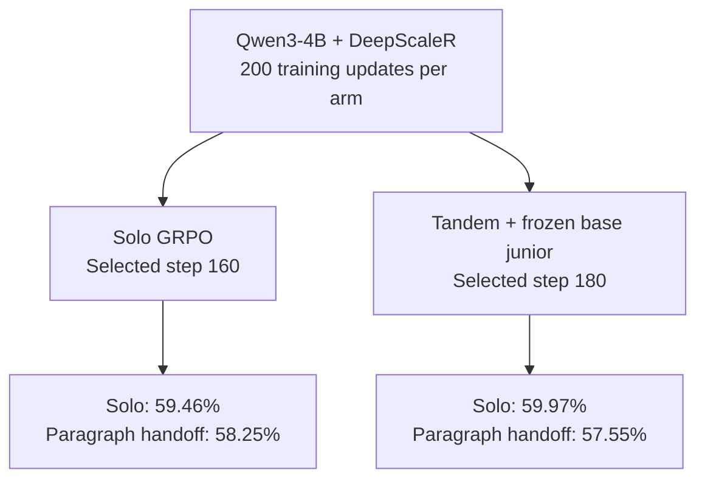

# Tandem RLVR: reproduction and extensions

Does reinforcement learning preserve a model's ability to reason with a weaker partner?
We compare **solo GRPO** with **Tandem RLVR**, where a trainable senior and frozen junior
co-write solutions. Only senior-authored tokens receive policy-gradient updates.

**Start here:** [Results and caveats](docs/RESULTS.md) ·
[Every variation, with diagrams](experiments/README.md) ·
[Setup and job interfaces](docs/WORKFLOWS.md) ·
[Released checkpoints](#released-checkpoints)

## Headline reproduction

The original claim is similar solo accuracy with better junior handoff performance.
Our completed Qwen3-4B replication reports **similar solo accuracy, but no clear handoff advantage**.
The diagram shows corrected test **pass@4**, averaged equally across four benchmark groups
(1,064 problems); pass@4 estimates success in four attempts.

Tandem also reduces marginal token-distribution drift by **15.13%** versus GRPO
([Figure 3](docs/FIGURE3.md)). These are documented single-seed results: both models
were trained with an incomplete math verifier, and corrected evaluation cannot undo
those training rewards. Read the [grading audit](docs/REPRODUCTION_AUDIT.md) before
interpreting the comparison. [Full result table and evidence availability](docs/RESULTS.md).

## What each variation tests

Each linked workflow has a compact diagram, its recorded outcome/status, and entrypoints.

| Variation | What changes / what it asks | Details |
| --- | --- | --- |
| [Asymmetric pair](experiments/README.md#asymmetric-qwen35-pair) | Start with a 9B senior and 2B junior: does compatibility survive an initial capability gap? | [Protocol](docs/QWEN35_PAIR.md), [pair probe](train/check_pair.py) |
| [Native word handoff](experiments/README.md#native-word-handoff) | Evaluate the training-time switching schedule and trace who emitted errors or repairs. | [Execution options](docs/WORD_HANDOFF_EXECUTION.md) |
| [Shorthand and concepts](experiments/README.md#shorthand-and-concepts) | Test whether repeated matrix operations or shared logical deductions develop reusable shorthand. | [Pilot protocols](experiments/README.md#shorthand-and-concepts) |
| [Length pressure](experiments/README.md#length-pressure) | Add a token cost: does shorter reasoning remain correct? | [Results and mechanism](docs/LENGTH_PENALTY_PILOTS.md) |
| [Natural-language drift](experiments/README.md#natural-language-drift) | Train small base models on GSM8K using correctness alone; inspect emerging conventions. | [Protocol](docs/NATURAL_DRIFT_PILOT.md) |
| [Method Atlas and elegance](experiments/README.md#method-atlas-and-elegance) | Reward elegant reasoning, then test generalization to held-out methods. | [Dataset audit](docs/METHOD_AUDIT.md), [RL protocol](docs/ELEGANCE_RL.md) |
| [APPS coding](experiments/README.md#coding) | Replace math problems with programs checked by executable tests. | [Protocol](docs/APPS.md), [migration recovery](docs/APPS_MIGRATION.md) |
| [MedCalc](experiments/README.md#medcalc) | Transfer the comparison to verified medical calculations. | [Protocol and launchers](experiments/medcalc/README.md) |

## Run the reproduction

Follow [setup and job interfaces](docs/WORKFLOWS.md), then the
[training protocol](docs/FRESH_TRAINING.md) and [evaluation protocol](docs/FIGURE2.md).
Site paths and GPU allocations are explicit inputs; the job wrappers handle saved-state resumption.

| Step | What it does | Entry points |
| --- | --- | --- |
| 1. Prepare data | Pin the source, make disjoint train/held-out splits, and record hashes. | [Dataset builder and manifest](data/build_deepscaler.py) |
| 2. Train both arms | Run smoke checks, then matched policy updates; Tandem freezes the junior and masks its loss. | [Submit](slurm/submit-training.sh), [job](slurm/train-figure2.sbatch), [solo GRPO](train/vanilla_grpo.sh), [Tandem](train/tandem_grpo.sh) |
| 3. Select weights | Check checkpoint integrity and observed validation evidence; write the model manifest. | [Verify](train/figure2_checkpoint.py), [select](eval/select_figure2.py) |
| 4. Evaluate | Measure solo accuracy, paragraph-handoff accuracy, and junior cross-entropy on saved senior traces. | [Job](slurm/figure2.sbatch), [solo](eval/solo.py), [handoff](eval/handoff.py), [legibility](eval/legibility.py) |
| 5. Aggregate and audit | Build Figure 2 with bootstrap uncertainty; regrade saved text without losing original grades. | [Figure 2](eval/figure2.py), [regrade](eval/regrade.py), [result format/provenance](eval/common.py) |

Training switches stochastically at **word boundaries**; Figure 2 evaluation alternates
at **paragraph boundaries**. [Execution options](train/execution.sh) configure the existing
trainer. [Checkpoint storage](docs/ARCHITECTURE.md#other-fork-changes) separates recovery
saves from retained evaluation exports with `PERSIST_HF_INTERVAL`.

## Inspect and understand the implementation

| Read or run | What you learn |
| --- | --- |
| [Training progress](eval/training_progress.py) | Reward, validation, response lengths, truncation, and training health. |
| [Comparison browser](eval/comparison_browser.py) / [trace UI](ui/comparison/) | Inspect saved responses side by side, including available token authorship. |
| [Figure 3 analysis](eval/figure3.py) | Measure marginal token drift and Jensen–Shannon divergence from solo outputs. |
| [Architecture](docs/ARCHITECTURE.md) / [fork patches](third_party/COMMIT_LOG.md) | Follow authorship from the native sampler to the senior-only loss. |
| [Tests](tests/README.md) | Check switching, loss masking, validation, and aggregation contracts. |

## Released checkpoints

Trained policies are hosted at
[cge7-tandem-rlvr/tandem-rlvr](https://huggingface.co/cge7-tandem-rlvr/tandem-rlvr).
Use the listed `subfolder=`; Tandem exports contain the trained senior only.

| Subfolder | Experiment | Senior initialization | Frozen junior | Step | Validation pass@4 |
| --- | --- | --- | --- | --- | --- |
| `grpo` | DeepScaleR reproduction | Qwen3-4B-Instruct-2507 | None | 160 | 0.674 |
| `tandem` | DeepScaleR reproduction | Qwen3-4B-Instruct-2507 | Qwen3-4B-Instruct-2507 | 180 | 0.656 |
| `qwen35-9b-2b/grpo` | Asymmetric math | Qwen3.5-9B | None | 200 | 0.752 |
| `qwen35-9b-2b/tandem` | Asymmetric math | Qwen3.5-9B | Qwen3.5-2B | 200 | 0.694 |
| `apps/grpo` | APPS coding | Qwen3-4B-Instruct-2507 | None | 200 | 0.785 |
| `apps/tandem` | APPS coding | Qwen3-4B-Instruct-2507 | Qwen3-4B-Instruct-2507 | 200 | 0.780 |

Validation uses each arm's own rollout protocol, so these columns are **not matched
test comparisons**. The Hugging Face repository's `checkpoint_manifest.json` records
base revisions, selection evidence, and SHA-256 hashes. See the
[experiment guide](experiments/README.md) for which evaluations have reported results.
