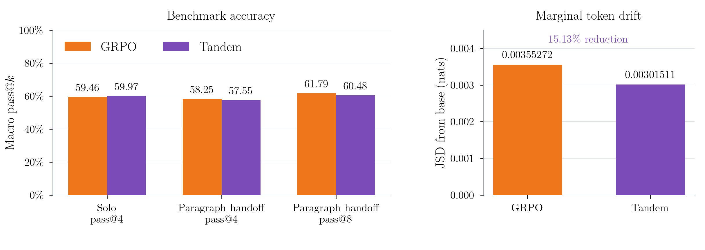
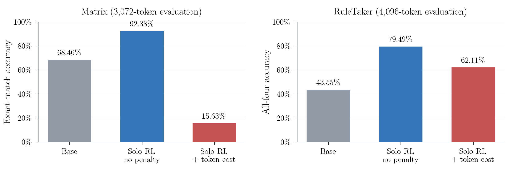

# Results at a glance

Tandem RLVR asks whether training with a frozen partner preserves solo reasoning
while making the trained model's reasoning easier for that partner to continue.
Our Qwen3-4B runs report comparable solo scores and less token drift, but **do not
reproduce the paper's clear paragraph-handoff advantage**.

This guide summarizes the experiment records available on October 14, 2026.
See the
[plot index and source files](figures/README.md) and [experiment map](../experiments/README.md).

## Headline comparison: Figure 2

Both arms start from the same Qwen3-4B-Instruct-2507 base and train for 200 updates
on DeepScaleR. Validation selects GRPO step 160 and Tandem step 180. Tandem trains
with a frozen copy of the base, switching at word boundaries; only senior-authored
tokens receive policy loss. See the [training protocol](FRESH_TRAINING.md).

This summary plot uses the numerical records below; it does not reconstruct the
missing full pass@k curves or their error bands. [Values and plotting script](figures/README.md#reproducible-summary-plots).

The [completed, corrected evaluation](REPRODUCTION_AUDIT.md#completion-update--2026-10-09-pacific)
covers 1,064 problems: AMC 121, AIME 90, Minerva 272, and OlympiadBench 581.
Each benchmark has equal weight in the macro average. Solo uses 32 attempts per
problem; handoff uses eight complete responses, alternating models at paragraph
breaks within a shared 3,000-token budget. `pass@k` estimates the probability of
at least one correct answer in *k* attempts.

| Macro metric | GRPO | Tandem | Tandem − GRPO |
|---|---:|---:|---:|
| Solo pass@4 | 59.46% | 59.97% | +0.51 points |
| Paragraph handoff pass@4 | 58.25% | 57.55% | −0.70 points |
| Paragraph handoff pass@8 | 61.79% | 60.48% | −1.31 points |

These small differences describe one training run per arm. They do not establish
that either method is generally better. The [evaluation protocol](FIGURE2.md)
also records the paper's comparison targets and sampling choices.

### Why the grading correction matters

The original training and evaluation environments omitted the authors' optional
math-verification dependencies, causing false negatives. Restoring those packages
and correcting scientific-notation parsing largely removed the apparent Minerva
deficit: corrected solo pass@4 is 56.04% for GRPO and 56.95% for Tandem.
**Regrading fixes reported scores, not the earlier policy updates or checkpoint
selection.** The selected checkpoints still reflect the original rewards, and
Tandem validation observations at steps 20 and 160 are missing. Corrected absolute
scores should not be equated with the paper's scores without matching its runtime.
See the [grading audit and limitations](REPRODUCTION_AUDIT.md#confirmed-grading-problem).

## Token drift: Figure 3

Across 34,048 solo responses per arm, Tandem's marginal token distribution stays
closer to the base on several diagnostics:

| Diagnostic | Reported result |
|---|---|
| Jensen–Shannon divergence from base | GRPO 0.00355272; Tandem 0.00301511 nats |
| Reduction in divergence | **15.13%**, versus the paper's 37% |
| Selected top-500 shifted tokens ending closer to base | **83.2%** |
| Opposite-direction movement / Spearman correlation | 84.0% / −0.548 |

This partially supports reduced drift. The drift-survival curves cross, and the
selected examples do not show a simple markup-versus-natural-language split.
These are pooled token-frequency statistics with documented reconstruction
choices and no bootstrap intervals; they do not measure human readability or
the junior's conditional cross-entropy. See [definitions, choices, and results](FIGURE3.md).

## Word handoff and error recovery

The [native-word comparison](REPRODUCTION_AUDIT.md#reconnected-scheduling-audit--2026-10-09-late-pacific)
reports an **interim 737-problem** macro pass@8 of 58.44% for GRPO and 58.72% for
Tandem. No final matched comparison is recorded. The latest math-run update is
October 10: GRPO completed; Tandem had 993/1,064 saved problems before replacement.
This is a historical status, not a live queue check. Word evaluation also changes
decoding to the training settings, so it does not isolate switching schedule.

The [manual case study](WORD_HANDOFF_CASE_STUDY.md) finds mistakes and repairs by
both models, with no demonstrated Tandem recovery advantage. On one selected
arithmetic problem, nine failed traces had four base-authored and five
senior-authored first substantive errors. Across the 737 matched problems,
62.6% of GRPO failures and 63.6% of Tandem failures ended at the token limit.
The proposed matched-prefix recovery experiment remains a proposal.

## Asymmetric benchmark figure: Qwen3.5-9B / 2B

> **Figure pending:** add the original benchmark PNG/SVG and machine-readable
> scores here, with the model/checkpoint identity, coverage and uncertainty definition.

Both step-200 policies are released. A reference screenshot was supplied during
review, but the original export and score JSON are not in this checkout, so this
section reserves the figure without transcribing approximate scores.
[Protocol](QWEN35_PAIR.md) · [Figure checklist](figures/README.md#pending-9b2b-benchmark-figure).

## Pilot results: accuracy versus length pressure

Correctness-only RL improves these tasks; adding the tested length cost lowers
accuracy, especially on matrix transformations. These are solo-RL pilots.
[Controls and diagnosis](LENGTH_PENALTY_PILOTS.md) · [All variation workflows](../experiments/README.md).

## What is available to verify

This checkout includes the evaluation code, benchmark data, experiment records,
and [training-summary artifacts](../results/training-progress/completed-20261008.json).
Reproducible summary plots are now in
[`docs/figures/`](figures/README.md). Original Figure 2 generations, corrected score JSONs, Figure 3 token counts, and word
case-study evidence referenced by the records are **local or cluster artifacts
that are not committed**. Their links may require the original results directory.
The summary charts use committed numerical transcriptions; regenerating the full
original Figure 2/3 plots requires those saved outputs. Follow the [current workflows](WORKFLOWS.md) to run the
pipeline, or the [trace-browser guide](COMPARISON_BROWSER.md) to inspect available traces.
