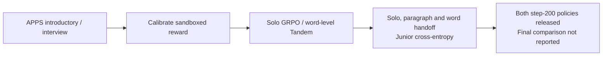
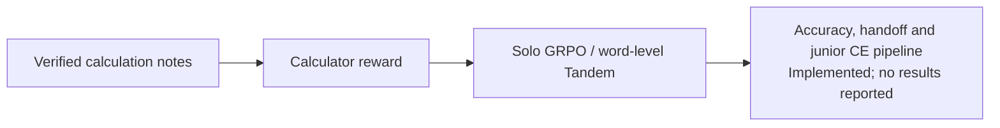
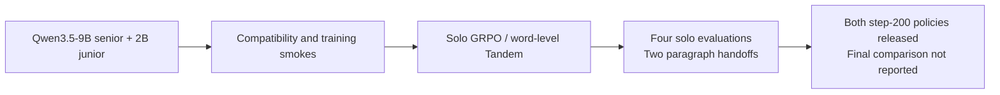
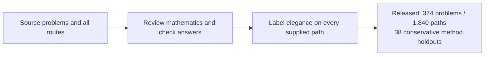
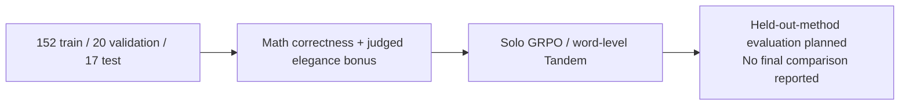
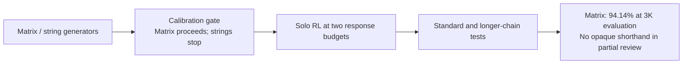
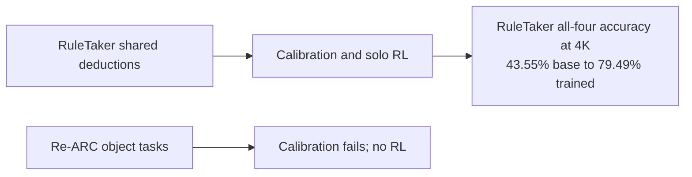
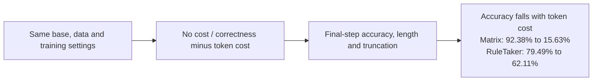
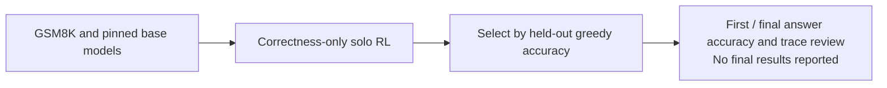
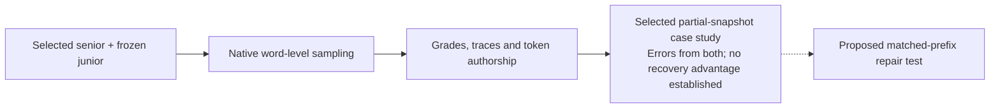

# Experiment workflows

These variations reuse the reproduction trainer and utilities. Start with the
[results guide](../docs/RESULTS.md), [released checkpoints](../README.md#released-checkpoints)
and [workflow interfaces](../docs/WORKFLOWS.md).
Statuses summarize repository records through October 14, 2026, not live jobs.

## Coding

APPS tests whether Tandem's handoff behavior extends to executable Python solutions.
Both 200-step policies are released; the latest record describes sharded final
evaluation and grader recovery, without a final aggregate comparison.

[Prepare](coding/build_apps.py) → [calibrate and evaluate](coding/campaign.py) →
[submit campaign](coding/submit.py), using the [executable reward](coding/reward.py).
[Protocol](../docs/APPS.md) · [Run evidence](../docs/APPS_RUN.md) · [Checkpoint migration](../docs/APPS_MIGRATION.md).

## MedCalc

MedCalc transfers the comparison to verified clinical calculations with numeric,
date and duration checks; the pipeline is implemented, but no empirical comparison
is reported. The official test split is reserved for evaluation.

[Prepare](medcalc/build_data.py) → [train](medcalc/train.sh) →
[evaluate](medcalc/evaluate.sh) → [report](medcalc/report.py).
[Protocol, environment and interfaces](medcalc/README.md).

## Asymmetric Qwen3.5 pair

This extension trains a 9B senior with a frozen 2B junior to test an initially
unequal pair. Both step-200 policies are released; validation scores use each
arm's own rollout mode, and a final matched benchmark comparison is not reported.

[Pinned models](../eval/qwen35-models.json) → [pair probe](../train/check_pair.py) →
[train](../slurm/train-figure2.sbatch) → [select](../eval/select_figure2.py) →
[evaluate](../slurm/figure2.sbatch). [Protocol and evidence](../docs/QWEN35_PAIR.md) ·
[Rollout defect investigation](../docs/QWEN35_COLLAPSE.md) · [Training performance](../docs/QWEN35_SPEED.md).

## Method Atlas and elegance

### Audited method dataset

Method Atlas collects structural shortcuts and elementary alternatives for method
holdouts. The release has 374 answer-checked problems and 1,840 labeled paths;
elegance labels are model judgments, not measured weaker-model accessibility.

[Curate](method_audit/curate.py) → [review](method_audit/review.py) →
[verify answers](method_audit/verify.py) → [label elegance](method_audit/elegance.py) →
[package](method_audit/package.py) / [inspect](method_audit/serve.py).
[Audit protocol](../docs/METHOD_AUDIT.md) · [Method-family boundaries](../docs/METHOD_FAMILIES_AUDIT.md) ·
[Dataset and limitations](../data/method-elegance/README.md).

### Elegance RL

This tests correctness plus a bonus for valid, elegant derivations using the
9B/2B pair, with complement counting, Vieta and power of a point held out.
The recorded runs reached recovery checkpoints; no final comparison is reported.

[Prepare fixed holdouts](elegance/prepare.py) → [judged reward](elegance/reward.py) →
[solo/Tandem training](elegance/job.sbatch). [Protocol and run evidence](../docs/ELEGANCE_RL.md).

## Shorthand and concepts

### Matrix and string shorthand

Correctness-only solo RL tests whether repeated transformations produce useful
shorthand. The 2K-trained matrix arm improved test accuracy from 68.46% to 94.14%
at 3K evaluation; partial blinded review found no opaque shorthand, while strings failed calibration.

[Build splits](shorthand/build_shorthand.py) → [calibrate](shorthand/slurm/shorthand-eval.sbatch) →
[submit](shorthand/submit.sh) → [train](shorthand/slurm/shorthand-train.sbatch) →
[verify](shorthand/check_shorthand.py) → [evaluate](shorthand/shorthand.py) →
[blinded review](shorthand/review_shorthand.py).
[Protocol](../docs/SHORTHAND_EXPERIMENT.md) · [Initial failed pilot](../docs/SHORTHAND_RUN.md) ·
[Matrix evidence](../docs/ENGAGING_PILOT.md) · [Partial review](../results/pilot-review/blinded-ratings-20261008.json).

### Reusable concepts

RuleTaker shared deductions and Re-ARC object tasks test reuse beyond shorter
English. RuleTaker's 4K all-four accuracy rose from 43.55% to 79.49%; Re-ARC's
truncation gate blocked RL, and useful emergent jargon is not established.

[Build RuleTaker/Re-ARC splits](shorthand/build_concept_pilot.py), then use the shared
pipeline above. [Concept protocol and gates](../docs/CONCEPT_PILOTS.md) ·
[Later RuleTaker results](../docs/LENGTH_PENALTY_PILOTS.md#collapse-investigation-2026-10-10).

### Length pressure

A token cost tests whether compression encourages reusable conventions, using fresh
solo runs and matched no-penalty controls. It reduced matrix accuracy from 92.38%
to 15.63% and RuleTaker from 79.49% to 62.11%; the proposed normalization ablation remains unrun.

[Length adapter](shorthand/length_penalty.py) · [Intervention, controls and diagnosis](../docs/LENGTH_PENALTY_PILOTS.md).

Shared interfaces distinguish correctness, compression and semantic evidence:

| Interface | Contract |
| --- | --- |
| [Dataset builders](shorthand/build_shorthand.py) | Pinned generators and seed → disjoint hashed splits; [uv project](shorthand/env/pyproject.toml) supplies dependencies |
| [Correctness reward](shorthand/shorthand_reward.py) | Task, response, target → score and independent accuracy/format diagnostics |
| [Length adapter](shorthand/length_penalty.py) | Correctness and unpadded token count → optional penalized reward |
| [Checks](shorthand/check_shorthand.py) | Calibration/training artifacts → verification receipt or failure |
| [Evaluate](shorthand/shorthand.py) | Model, splits, token budgets → resumable traces, accuracy, lengths, truncation |
| [Submit](shorthand/submit.sh) | Tasks, two budgets, calibration job, explicit resources → guarded 100-step campaign |

[Submission interface and calibration probes](../docs/WORKFLOWS.md#pilot-submission).
Dataset artifacts remain in `data/shorthand/` and `data/concept-pilot/`; moving code does not change their hashes.

## Natural-language drift

This literature-informed GSM8K pilot tests drift under correctness-only solo RL
from base models. Qwen runs were submitted; Llama/Gemma access was blocked in the
recorded checks, and no final drift or accuracy results are reported.

[Prepare](drift/build_drift.py) → [train](drift/slurm/drift-train.sbatch) →
[select and evaluate](drift/drift.py). [Reward](drift/gsm8k_drift.py) is final numeric
correctness; first-answer accuracy is diagnostic. The [evaluation job](drift/slurm/drift-eval.sbatch)
saves resumable base/selected traces. [Protocol and limitations](../docs/NATURAL_DRIFT_PILOT.md).

## Native word handoff

This evaluates the training sampler's word-level schedule, alongside Figure 2's
paragraph handoffs. A selected partial-snapshot case study found errors from both
partners; it does not establish a Tandem recovery advantage, and fixed-prefix repair is proposed only.

[Evaluate](word_handoff/word_handoff.py) or use its [job](word_handoff/slurm/word-handoff.sbatch).
Training/evaluation decoding presets remain separate. [Protocol](../docs/FIGURE2.md#word-level-training-schedule-evaluation) ·
[Execution and profiling](../docs/WORD_HANDOFF_EXECUTION.md) · [Error attribution and recovery proposal](../docs/WORD_HANDOFF_CASE_STUDY.md).
